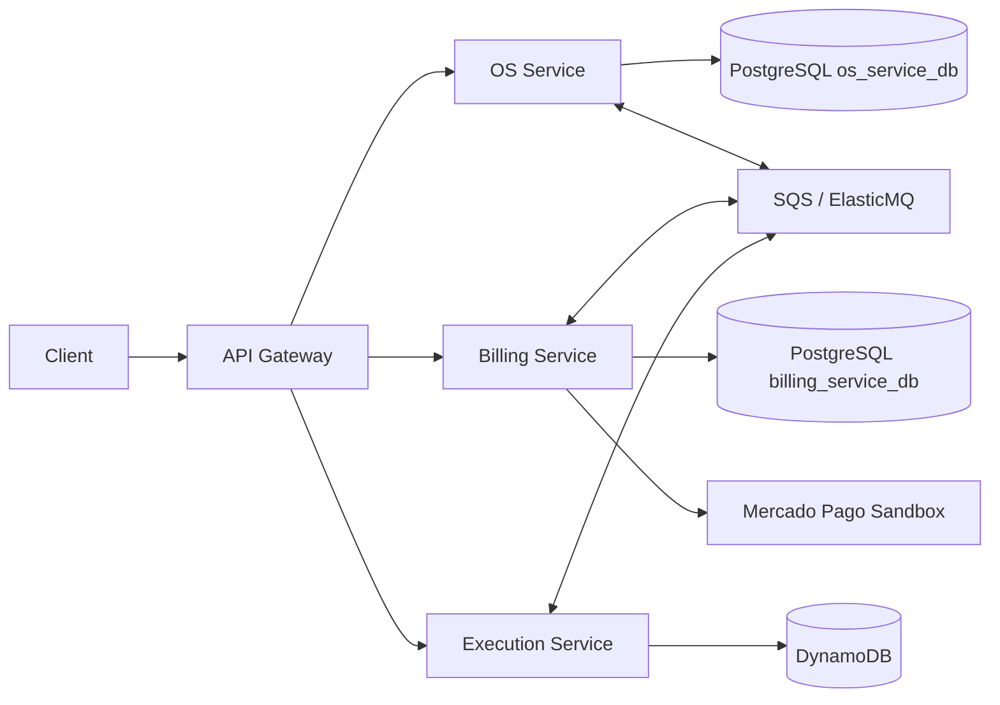

# Arquitetura da Fase 4

A solução evolui o monólito da Fase 3 para três microsserviços independentes no mesmo EKS: OS Service é dono da ordem e orquestra a Saga; Billing Service mantém catálogo, orçamento e pagamento; Execution Service mantém diagnóstico, fila e reparo. O monólito permanece como referência histórica.

APIs REST atendem comandos e consultas imediatas. Eventos assíncronos carregam envelope versionado, `event_id`, `correlation_id`, `causation_id`, `saga_id` e `order_id`. Outbox/Inbox, idempotência, retry e DLQ sustentam consistência eventual. Contratos: [AsyncAPI](contracts/asyncapi.yaml), [schemas](contracts/events/) e [ADRs](adrs/).

O diagrama detalhado está em [target-architecture.mmd](diagrams/target-architecture.mmd). Observabilidade usa logs JSON, propagação de correlação e New Relic por serviço. Nenhum serviço acessa o banco de outro.
