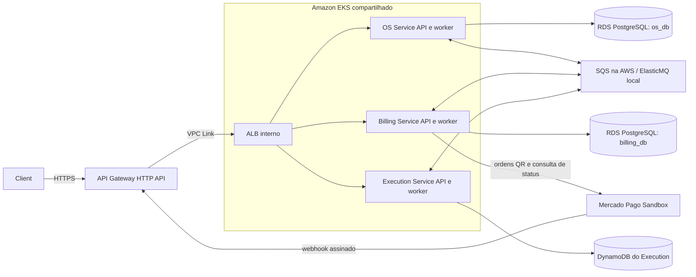

# Arquitetura da Fase 4

A solução evolui o monólito da Fase 3 para três microsserviços em repositórios próprios, implantados no mesmo EKS compartilhado. OS Service é dono da ordem e coordena a Saga; Billing Service mantém catálogo, orçamento e pagamento; Execution Service mantém diagnóstico, fila e reparo. O monólito permanece como referência histórica.

APIs REST atendem comandos e consultas imediatas. O API Gateway encaminha as rotas ao ALB interno por VPC Link; o EKS, a VPC e o RDS são compartilhados, enquanto cada serviço tem Deployment, worker, configuração e banco lógico/NoSQL próprios. OS e Billing usam bancos lógicos PostgreSQL separados no RDS; Execution usa DynamoDB. Nenhum serviço acessa diretamente o banco de outro.

Eventos assíncronos carregam envelope versionado, `event_id`, `correlation_id`, `causation_id`, `saga_id` e `order_id`. Outbox/Inbox, idempotência, retry e DLQ sustentam consistência eventual. Contratos: [AsyncAPI](contracts/asyncapi.yaml), [schemas](contracts/events/) e [ADRs](adrs/).

O diagrama detalhado está em [target-architecture.mmd](diagrams/target-architecture.mmd). Logs JSON e correlação foram observados nos serviços e nos access logs do API Gateway/CloudWatch. A instrumentação New Relic está configurada; a ingestão no painel ainda precisa ser capturada como evidência.

O estado operacional e as evidências atuais estão em [current-status.md](current-status.md); lacunas e decisões pendentes ficam em [known-limitations.md](known-limitations.md).
