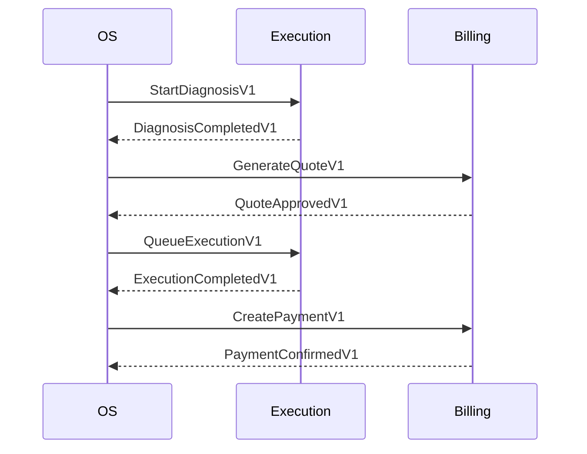

# Saga de ordem de serviço

O OS Service implementa a orquestração persistente dentro do próprio serviço, sem um quarto serviço. O fluxo feliz é: abrir OS, diagnosticar, gerar orçamento, aprovar, enfileirar e executar reparo, criar/confirmar pagamento e liberar entrega. A OS só chega a `DELIVERED` depois de `PaymentConfirmedV1`.

Eventos duplicados são absorvidos pelo Inbox; publicação atômica usa Outbox. Veja [ADR-002](adrs/ADR-002-saga-orchestration.md), [sequência completa](diagrams/saga-sequence.mmd) e os cenários do [BDD](bdd/features/service_order_saga.feature).

## Limites das compensações

| Falha/decisão | Comportamento atual | Classificação |
|---|---|---|
| Orçamento recusado | Cancela a OS e encerra a Saga como compensada | Compensação automática |
| Execução falha/cancelada antes do início do reparo | Cancela a OS | Compensação automática |
| Execução falha depois do início | Marca intervenção manual; reparo físico não é revertido | Recuperação manual |
| Pagamento rejeitado ou reembolsado | Marca intervenção manual; não apaga o reparo nem o pagamento | Recuperação manual |
| Falha externa ao criar order de pagamento | O worker pode repetir a entrega segundo a política SQS; rollback do reparo não é possível | Retry/operação; compensação de negócio não comprovada |

O enunciado pede rollback/compensação em qualquer etapa. As duas primeiras situações têm compensação automática; as demais vão para tratamento manual por envolverem ações irreversíveis. Isso é um limite explícito da implementação atual e não deve ser apresentado como compensação automática completa.

## Alcance do BDD

O `pytest-bdd` versionado cobre o fluxo feliz, falha antes do início do reparo e confirmação de pagamento duplicada usando as APIs dos três serviços, bancos de teste e fake do Mercado Pago. O harness aplica alguns eventos diretamente ao process manager e não valida a entrega real por SQS/ElasticMQ; os testes de mensageria dos serviços cobrem esse transporte separadamente.
