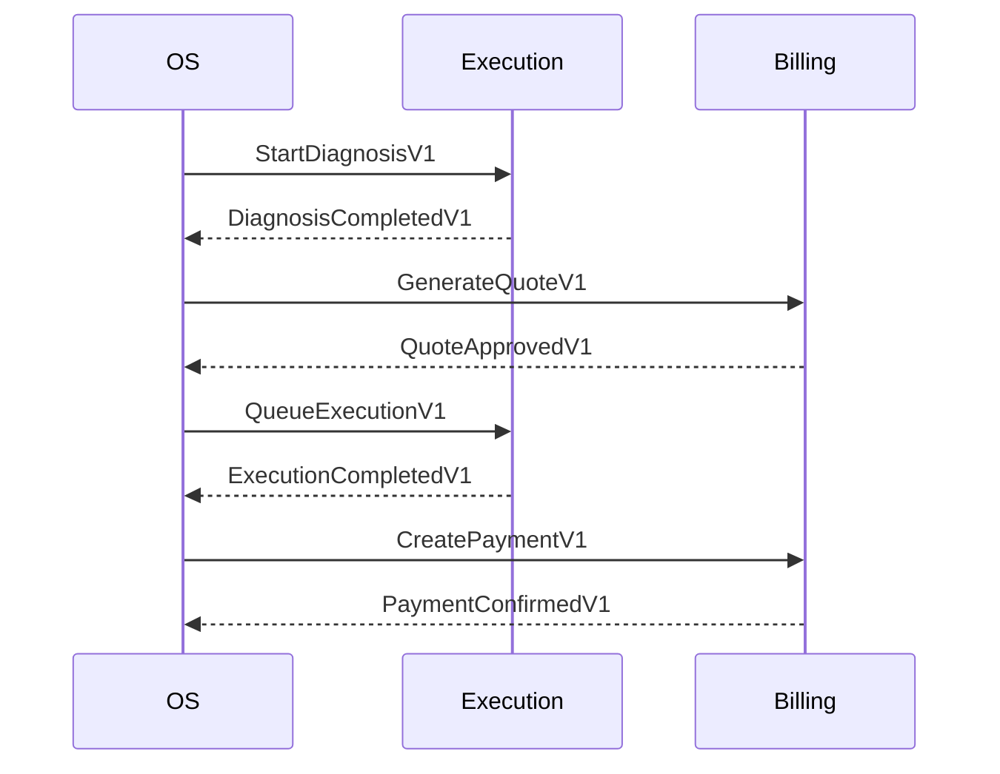

# Saga de ordem de serviço

O OS Service implementa orquestração persistente, sem um quarto serviço. O fluxo feliz é: abrir OS, diagnosticar, gerar orçamento, aprovar, enfileirar e executar reparo, criar/confirmar pagamento e liberar entrega. A entrega exige reparo e pagamento confirmados.

Falhas antes do reparo permitem cancelamento de orçamento/execução. Reparos concluídos são irreversíveis: a compensação vira tratamento manual. Pagamento confirmado admite reembolso, nunca simples exclusão. Eventos duplicados são absorvidos pelo Inbox; publicação atômica usa Outbox. Veja [ADR-002](adrs/ADR-002-saga-orchestration.md), [sequência completa](diagrams/saga-sequence.mmd) e testes do process manager/BDD.
